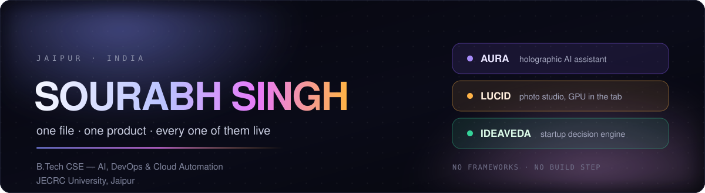

<div align="center">



<a href="https://sourabh7300.github.io"></a>
<a href="https://sourabh7300.github.io/resume.html"></a>
<a href="https://aura-live-81185.web.app"></a>
<a href="https://lucid-app-preview.web.app"></a>
<a href="https://ideaveda-live-app.web.app"></a>

<sub>Open to internships, junior roles and freelance work. The click is the résumé.</sub>

</div>

---

## Three products, three deployments, zero frameworks

Everything below is hand-written HTML, CSS and JS in a single file per product — no framework, no bundler, no `node_modules` in the app itself. What runs in the tab is exactly what is in the repo.

| | Product | Live | What it actually is |
|---|---|---|---|
| 🧬 | **AURA** | **[aura-live-81185.web.app](https://aura-live-81185.web.app)** | A holographic AI assistant in a **14,000-line** hand-written page: a 3D particle core drawn on canvas that reacts to her state, voice in and out, Hindi / Hinglish / English mirroring, vision, document RAG and long-term memory. The chat brain resolves follow-ups against the thread's topic instead of guessing, answers esports/schedule questions from fetched facts rather than memory, and keeps its model keys **server-side**. A gated autopilot squad keeps working, shipping and reporting from the server when nobody has her open. |
| 🎨 | **Lucid** | **[lucid-app-preview.web.app](https://lucid-app-preview.web.app)** | A desktop-class photo studio in one page: WebGL tone curves, HSL mixer, clarity, bloom, bokeh, halation, grain, masks, layers and batch export — plus a **48-template library** with live previews painted on *your own* photo, category search, a before/after slider, and an AI studio that edits from a sentence or an attached photo/video. The AI key never enters the visitor's browser. |
| 💡 | **IdeaVeda** | **[ideaveda-live-app.web.app](https://ideaveda-live-app.web.app)** | India's startup decision engine: **40 business ideas** with real investment and success numbers, city-fit scores, unit-economics and break-even calculators, 14 funding schemes (Mudra / PMEGP / Startup India), a stress-test risk score, 90-day plan + pitch generator, and an AI Guru that answers in Hinglish. |

<br/>

| 14,000+ | 48 | 40 | 15+ | 7 |
|:--:|:--:|:--:|:--:|:--:|
| lines in one file | Lucid templates | business ideas | live lab apps | public repos |

---

## More, also live

- **[Quantum Circuit Simulator](https://sourabh7300.github.io/quantum.html)** — build a circuit, watch the amplitudes collapse; a state-vector simulator in one page.
- **[Foodora](https://sourabh7300.github.io/foodora.html)** — food-delivery platform: 12 restaurants, 48 dishes with recipes in English, Hindi and Spanish.
- **[Groundwork](https://sourabh7300.github.io/groundwork.html)** — learn AI from zero, eight fully interactive lessons.
- **[Mercedes-Benz](https://sourabh7300.github.io/mercedes.html)** — cinematic brand showcase, pure CSS and canvas.
- **[Project Web](https://sourabh7300.github.io/project-web.html)** — every app in one gallery with live badges.

The DevOps side, all runnable: [Autonomous SRE](https://sourabh7300.github.io/sre.html) (four agents, detect → triage → remediate → verify), [CloudPilot](https://sourabh7300.github.io/cloudpilot.html), [LLMOps Pipeline](https://sourabh7300.github.io/llmops-pipelines/llmops-pipeline.html), [CI/CD Dashboard](https://sourabh7300.github.io/CICD-web-app/pipeline-dashboard.html), [Ephemeral Playgrounds](https://sourabh7300.github.io/Ephemeral-Playgrounds/ephemeral-playgrounds.html).

---

## Public repos

| Repo | Stack | What's inside |
|---|---|---|
| [**aura**](https://github.com/sourabh7300/aura) | HTML · Node · Express | Holographic AI: particle core, voice I/O, self-upgrading source, gated autopilot |
| [**sourabh7300.github.io**](https://github.com/sourabh7300/sourabh7300.github.io) | HTML · JS | The live portfolio and every app hosted on it — Lucid, IdeaVeda, AURA mirror, render backend |
| [**autonomus-SRE.html**](https://github.com/sourabh7300/autonomus-SRE.html) | HTML | 15+ single-file DevOps/SRE apps: incident responder, CloudPilot, ZEUS, JARVIS, Kin copilot |
| [**llmops-pipelines**](https://github.com/sourabh7300/llmops-pipelines) | HTML | LLMOps visualiser — dynamic GPU scaling from prompt to tokens |
| [**CICD-web-app**](https://github.com/sourabh7300/CICD-web-app) | HTML | CI/CD pipeline dashboard, builds and deploys traced end to end |
| [**Ephemeral-Playgrounds**](https://github.com/sourabh7300/Ephemeral-Playgrounds) | HTML | IaC-provisioned sandbox environments, visualised |
| [**sourabh7300**](https://github.com/sourabh7300/sourabh7300) | — | This profile |

---

## How I build

```txt
hand-written pixels      no frameworks      no build step
one file per product     keys stay server-side
if it can't load on a phone, it doesn't ship
```

<p>
  
  
  
  
  
  
  
  
  
  
  
  
</p>

---

<div align="center">


<br/>

**Every link on this page was opened and returned HTTP 200 on 28 October 2026.**

<sub>Built in Jaipur. Shipped to the world. — <a href="https://sourabh7300.github.io">portfolio</a> · <a href="https://sourabh7300.github.io/resume.html">résumé</a> · <a href="https://github.com/sourabh7300?tab=repositories">repositories</a></sub>

</div>
